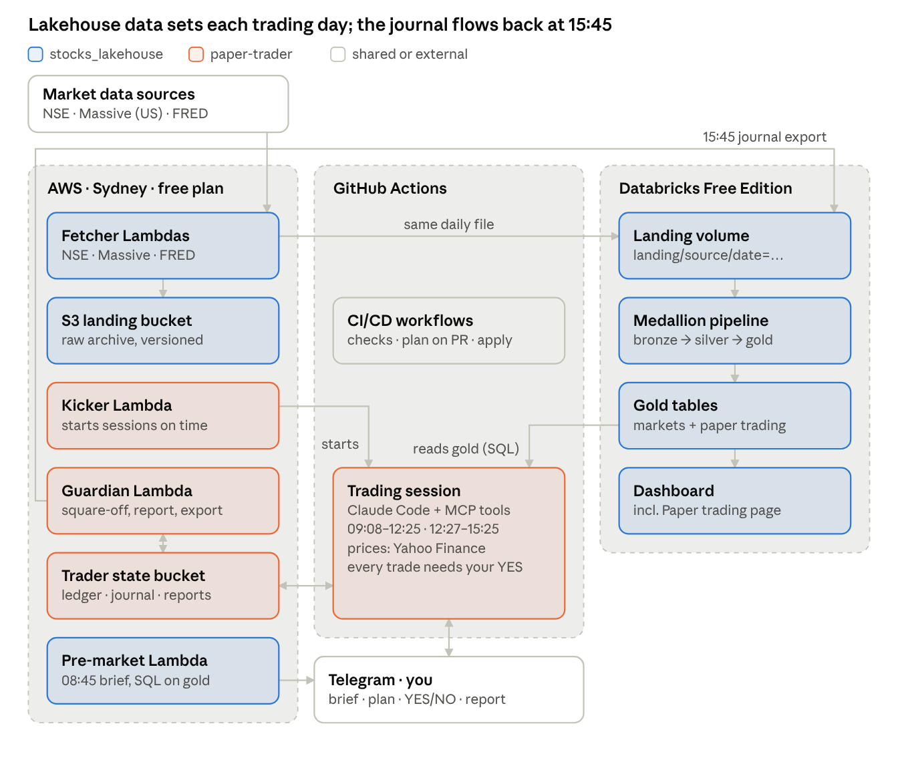

# paper-trader

A **mock intraday trader for NSE stocks** with dummy money (an Rs 40,000 intraday pool, part of an Rs 2,00,000 dummy portfolio). Claude reads the market,
proposes trades with reasons on **Telegram**, and nothing happens unless you tap **YES**. No broker, demat
or bank account is involved.

It builds on [stocks_lakehouse](https://github.com/bumblebee26/stocks_lakehouse): the lakehouse's
pre-market data (US move, India's usual opening gap after such days, VIX, unusual volume, ADRs) sets each
day's risk level and focus list.



Orange is this repo; blue is [stocks_lakehouse](https://github.com/bumblebee26/stocks_lakehouse).
More pictures, each explained: [docs/ARCHITECTURE.md](docs/ARCHITECTURE.md) (this repo's architecture, the
life of one trade).

## A trading day (IST, Mon–Fri)

| Time | What happens |
|---|---|
| 08:45 | Lakehouse pre-market brief arrives on Telegram (unchanged) |
| 09:08 | Kicker starts the **morning session**: Claude reads the lakehouse data, sends the day plan and focus list |
| 09:20–12:25 | Every 5 minutes: check positions, scan the focus list (up to 15 of 36 stocks across 11 sectors), propose setups. You tap YES / NO |
| 12:27 | Afternoon session. New entries stop at 14:30 |
| 15:10 | Everything squared off, then the day report |
| 15:12 / 15:40 | Guardian backstops: square-off and report if the session didn't |
| 15:45 | The day's journal and a portfolio snapshot (all pools and holdings) are copied to the lakehouse; its pipeline builds the trading and portfolio tables and dashboard pages |

Money is split into three dummy pools (Rs 2,00,000 in total): **intraday** Rs 40,000 (trading now), **swing**
Rs 60,000 (held in NIFTYBEES: the swing rules failed their backtest) and **long-term** Rs 1,00,000 (starts
in a later phase). If all pools
together fall 12% below their peak, a circuit breaker stops new buys until you send `/resume`. Every Friday
evening a **weekly report** explains the week in plain words. Every Saturday a GitHub Actions job sends
company financials for NSE's Nifty 200 list to the lakehouse, which scores them for the long-term pool.

Each proposal also lists the company's **NSE filings** from today and the last trading day (from the
lakehouse news feed), flags worrying ones (regulatory, rating, pledge) and an upcoming board meeting, and
names the **market mood** (trending up or down, jumpy, choppy). Stale prices pause proposals with an alert.

Each proposal starts with **a suggestion** ("YES, 65% for and 35% against") and explains itself in plain
words: what you'd buy or sell, why now, what you'd make or lose, and a **market check** of Nifty 50,
Sensex, the stock's sector index (Bank Nifty, Nifty IT), whether the price has already run, and the time
left. An **independent risk reviewer** (a second Claude, with no tools, that sees only facts gathered by
code, never the trading agent's pitch) tries to argue against each trade and gives its own verdict in
plain words. The percentage averages three scores: the live checks, the trading agent and the reviewer.
It is not a chance of profit. You still make the call. The lakehouse table `stocks.gold.trading_decisions` shows later how
your YES and NO calls worked out.

Send `/help` (or ask "what can you do?") for every command, with or without the `/`: `/ledger`, `/plan`,
`/exit SYMBOL`, `/news SYMBOL`, `/portfolio`, `/pause`, `/stop` (kill switch), `/resume`. They also appear in the bot's `/` menu, and the bot answers at any time:
within seconds during sessions, within ~2 minutes otherwise (evenings, weekends). A `/pause` sent in the evening
skips the next trading day. `EXIT RELIANCE` closes that position; `LEDGER` gives a statement: balance,
money in use, money free, and open positions with live P&L. Every fill and exit also ends with a one-line ledger.

## Repository layout

```
trader/            Engine, scanner, brief and news (lakehouse), pools, reviewer, weekly report, export,
                   storage (S3/local), Telegram, MCP server, Lambda handlers. Standard library + boto3 only.
jobs/              fundamentals.py: weekly company financials (Nifty 200) for the lakehouse
backtest/          Swing-pool backtest on the lakehouse's NSE daily prices
prompts/           trading_rules.md: the rules Claude follows in a session
infra/
  modules/         secure_bucket: private, encrypted, versioned, HTTPS-only S3 (same as stocks_lakehouse)
  aws/             State bucket, kicker, guardian + responder Lambdas, schedules, IAM, SSM, session CI user
tests/             Unit tests (no network or AWS needed)
scripts/           render_diagrams.sh (re-render docs/diagrams)
.github/           CI (tests, fmt, validate), Terraform CD (plan on PR, apply on merge), trading session,
                   company fundamentals (weekly), swing backtest (manual)
docs/              ARCHITECTURE, SETUP, OPERATIONS, TROUBLESHOOTING; docs/diagrams/ holds diagram sources and images
```

## How changes ship

```
edit on dev  ──push──▶  CI: tests, MCP check, terraform fmt + validate
              ──PR to main──▶  terraform plan posted as a PR comment
              ──merge──▶  terraform apply; the next trading session uses the new code
```

`main` only changes through pull requests (same rules as stocks_lakehouse).

## Documentation

| Doc | Read it when |
|---|---|
| [docs/PLATFORM.md](docs/PLATFORM.md) | The whole platform with stocks_lakehouse: diagram, daily timeline, contracts, security, costs |
| [docs/ARCHITECTURE.md](docs/ARCHITECTURE.md) | How it fits together and why it's built this way |
| [docs/SETUP.md](docs/SETUP.md) | Setting it up: every step in order, Windows commands |
| [docs/OPERATIONS.md](docs/OPERATIONS.md) | Day to day: changes, rules, monitoring, secrets |
| [docs/TROUBLESHOOTING.md](docs/TROUBLESHOOTING.md) | Something failed |

## Laptop mode (optional)

The same tools run locally in Claude Desktop with state in `journal/`: copy `.env.example` to `.env`, run
`pip install -r requirements.txt`, test with `python trader/server.py --test`, then add
`trader/server.py` as an MCP server in Claude Desktop. Don't run laptop mode while GitHub sessions are on:
only one program can read the Telegram bot at a time.

*Mock trading with dummy money for learning. Not investment advice.*
