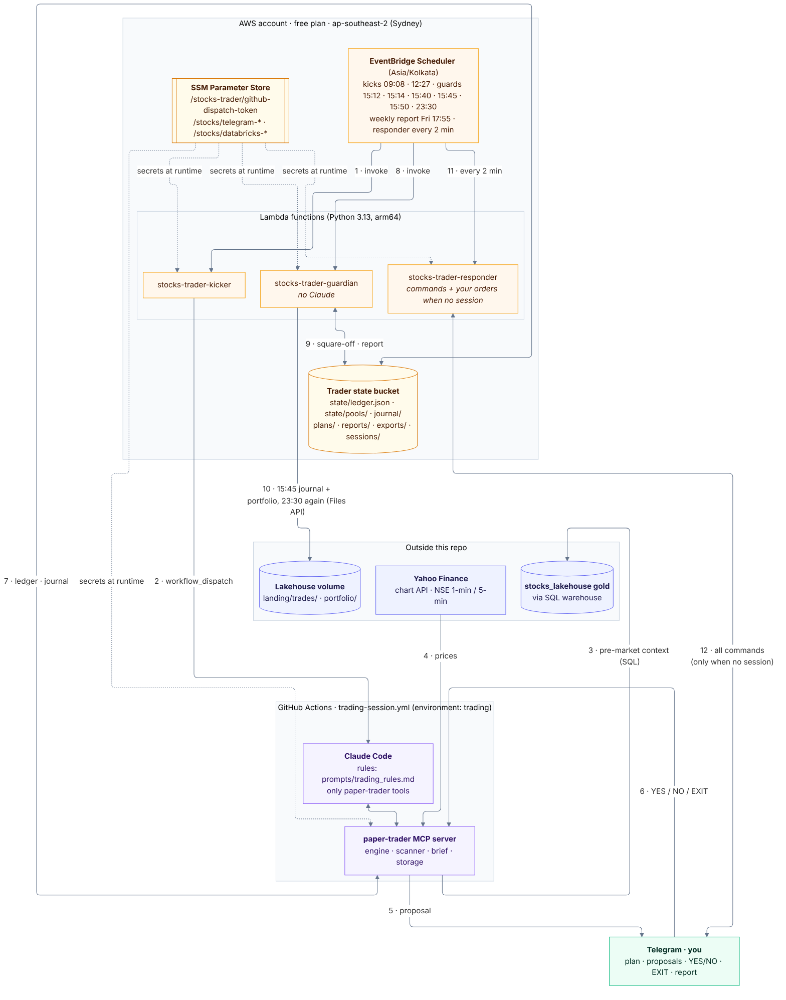
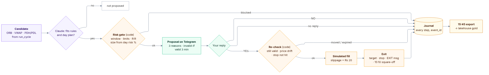

# Architecture

## Overview

| Step | Arrow | What happens |
|---|---|---|
| **1–2** | Scheduler → kicker → session | At 09:08 and 12:27 IST the kicker starts `trading-session.yml` through the GitHub API. GitHub's own cron (09:16, 12:36) is the backup; a phase runs once per day. |
| **3** | Session → lakehouse gold | `premarket_context` reads the lakehouse's gold tables over SQL; `start_day` turns them into today's risk and focus list. |
| **4** | Yahoo → session | 1-minute and 5-minute NSE candles for scanning, fills and exits. |
| **5–6** | Session ↔ Telegram | Proposals with YES/NO buttons; your replies and `EXIT SYMBOL` messages come back through long polling. |
| **7** | Session ↔ state bucket | Every tool call reads and writes the ledger; every event is appended to the day's journal. |
| **8–9** | Scheduler → guardian ↔ state bucket | 15:12 square-off and 15:40 report, only if the session didn't; 15:14 swing pool parked in NIFTYBEES; Fri 17:55 weekly report. |
| **10** | Guardian → lakehouse volume | 15:45 export of the day's journal (`landing/trades/`) and a portfolio snapshot of all pools and holdings (`landing/portfolio/`), the lakehouse's input for the trading and portfolio tables. |
| **11–12** | Scheduler → responder ↔ Telegram | Every 2 minutes, only when no session is live (fresh heartbeat or a phase claimed in the last 10 min): answers every command (`/help`, `/ledger`, `/plan`, `/news`, `/portfolio`, `/pause`, `/stop`, `/resume`) from the S3 state. Telegram allows one reader, so the responder and the session never poll at the same time. |

Dotted arrows: secrets read from SSM at runtime.

### Platform context

This repo is half of a platform with [stocks_lakehouse](https://github.com/bumblebee26/stocks_lakehouse).
The two meet at a few fixed points: the session reads gold before the open and the news file during the day,
the guardian sends the journal and portfolio snapshot back at 15:45, and the Saturday fundamentals job sends
company financials. Both repos together, with their diagrams: [PLATFORM.md](PLATFORM.md).

### The life of one trade

Purple steps are Claude's judgment, orange steps are enforced in code, green steps are yours. Every outcome,
including the trades that never happen, ends in the journal, so the lakehouse can show what skipped proposals
would have made.

## Components

| Component | What it does |
|---|---|
| **Trading session** (GitHub Actions) | Morning (09:08–12:25) and afternoon (12:27–15:25) runs. Claude Code uses the MCP tools in `trader/server.py`; rules in `prompts/trading_rules.md`. |
| **MCP tools** | `premarket_context`, `start_day`, `run_cycle`, `propose_trade`, `wait_for_decision`, `execute_approved_trade`, `wait_for_next_candle`, `end_of_day_report` and a few helpers. |
| **Engine** (`trader/engine.py`) | Dummy ledger, risk gate, sizing, approvals with expiry, simulated fills with slippage and brokerage, stop/target exits, square-off, report. Every rule that matters is enforced in code, not left to Claude. |
| **Brief** (`trader/brief.py`) | Reads the lakehouse gold tables and turns them into the day plan: risk per trade from VIX, bias from India's historical gap after similar US days, unusual-volume and ADR candidates. |
| **S3 state bucket** | The only memory between runs: ledger, journal CSVs, plans, reports, session claims, heartbeat. |
| **Kicker Lambda** | Starts each session on time through the GitHub API. GitHub's own cron is kept as a backup. |
| **Risk reviewer** | `trader/reviewer.py`, inside the session: before each proposal is sent, a second Claude (`claude -p`, no tools, same subscription) gets only code-gathered facts (trade, live Nifty/Sensex/sector, recent candles, plan, today's earlier trades) and argues against it. Its verdict and % join the suggestion. Off unless `REVIEWER=on` (the workflow sets it); any failure just leaves it out. |
| **Responder Lambda** | Answers Telegram commands outside sessions (evenings, weekends, holidays) within ~2 minutes. `/pause` sent after 14:30 applies to the next trading day. Skips while a session is live. |
| **Guardian Lambda** | Runs without Claude. Squares off at 15:12 and sends the report at 15:40 if the session didn't (crash, usage limit, runner failure). At 15:14 it puts the swing pool's idle cash into NIFTYBEES, at 15:45 it exports the day's journal and portfolio snapshot to the lakehouse, and on Fridays at 17:55 it sends the weekly report. |
| **Auto mode and feedback** (`trader/engine.py`) | `/auto on|off`: in auto mode a proposal with a suggestion of 55%+ is placed at once, otherwise skipped; 👍/👎 buttons record the user's opinion (`user_feedback`), EXIT closes. 6 trades a day; off at the weekly brake. |
| **Track record** (`trader/track.py`) | Reads `stocks.gold.track_record` once per session: how past proposals turned out by setup, hour, mood, suggestion band, reviewer, mode and rating. Shown in every proposal with counts and given to Claude each morning. |
| **Exit rules on trial** (`trader/exits.py`) | At the day report, each closed trade is replayed on its 1-minute candles under the current exits and four alternatives (stop to entry at +1R, sell half at +1R, trailing stop, 60-minute time stop), plus a day profit lock. Journaled as `exit_variants` / `profit_lock_shadow`; shown in the day and weekly reports. Changes no real trade. |
| **Pools** (`trader/pools.py`) | Ledgers for the swing (Rs 60,000, held in NIFTYBEES while its rules are on hold) and long-term (Rs 1,00,000) pools, and the portfolio circuit breaker: all pools 12% below their peak stops new buys until `/resume`. |
| **News** (`trader/news.py`) | Reads the lakehouse's `latest.jsonl` news file (today and the last day) through the Databricks Files API for each proposal and `/news`. Any failure means "news unavailable", never a stopped session. |
| **Backup feed** (`trader/export.py`) | The day's journal as JSON lines (every event has a unique `event_id`, plus a final ledger snapshot) written to S3 `exports/` and to the lakehouse volume `landing/trades/`. The lakehouse turns it into `stocks.gold.trades`, `trading_daily` (with a reconciliation against the ledger), `trading_by_setup`, `trading_by_hour` and `trading_decisions`, and the **Intraday trading** dashboard page. The same 15:45 run writes `exports/portfolio/date=<day>/portfolio.jsonl` (one row per pool and per holding) and pushes it to `landing/portfolio/`, which feeds `stocks.gold.portfolio_daily`, `holdings_latest` and the **Portfolio** page. |
| **Long-term shadow** (`jobs/longterm_shadow.py`) | GitHub Actions, Saturdays 10:15 IST, no Claude. Reads this week's picks from `stocks.gold.longterm_candidates` and acts in a shadow ledger (`state/pools/long_term_shadow.json`, never in the portfolio totals): buys the next pick (two on a 5%+ Nifty dip), sells what stops qualifying, trims above 18%. Telegram report with reasons; weekly snapshot in `shadow/longterm/`. |
| **Backtests** (`backtest/`) | Manual GitHub Actions jobs, no Claude, results to Telegram and `backtests/` in the state bucket. `swing.py` / `run_swing.py`: swing rules on NSE daily prices (failed: swing on hold). `longterm.py` / `run_longterm.py`: the long-term selection as of 1 Jul 2025 (and a 2026 re-pick) vs NIFTYBEES; `--universe=traded` picks from the most traded stocks of Apr–Jun 2025 to remove index-list hindsight. |
| **Company fundamentals** (`jobs/fundamentals.py`) | GitHub Actions, Saturdays 07:15 IST, no Claude. Reads NSE's Nifty 200 list (falls back to the 250 most traded NSE stocks if it can't), adds the watchlist, fetches 4 years of annual and recent quarterly figures from Yahoo, and pushes them to `landing/fundamentals/` and the list itself to `landing/index_members/`. The lakehouse builds `company_fundamentals` and `longterm_candidates` from them. |
| **CI/CD** | Same as stocks_lakehouse: checks on every push, plan on PR, apply on merge to `main`. |

## Why it's built this way

### 1. The AWS account is on the free plan (re-validated Nov 2026)

The first design used an EC2 server in Mumbai running Claude Code all day. On this account that fails with
`explicit deny in a service control policy`:

| Free-plan rule | First design | Now |
|---|---|---|
| Only `us-east-1`, `us-west-2` and the project region | ap-south-1 (Mumbai) | **ap-southeast-2 (Sydney)** |
| Only S3, Lambda, EventBridge Scheduler, SSM, IAM roles, CloudWatch Logs | EC2, security group, Session Manager, AWS Budgets | **S3, Lambda, Scheduler, SSM, IAM roles only** |
| No IAM identity providers (no GitHub OIDC) | — | IAM users with access keys in GitHub environments, like the lakehouse |
| Admin IAM users are discouraged; sign in with `aws login` | `terraform` user with AdministratorAccess | **Delete that user**; use `aws login` |
| Spend limit is built in | AWS Budget resource | Not needed |

Lambda runs at most 15 minutes, so it can't host a 3-hour Claude Code session. That's why the session runs
in **GitHub Actions** (free for public repos, up to 6 hours per job) and AWS keeps only the small,
always-allowed parts.

### 2. Claude access

The session uses your **Claude Pro/Max subscription** through `CLAUDE_CODE_OAUTH_TOKEN` (from
`claude setup-token`, valid 1 year). No API key. Usage counts against your plan's limits; two ~3-hour
sessions a day are heavy on Pro. If a session hits a limit and stops, the guardian still squares off.

### 3. Sharing with stocks_lakehouse

| Shared | How |
|---|---|
| Terraform state bucket | Same bucket, key `paper-trader/aws/terraform.tfstate` |
| CI plan/apply users | `stocks-gha-plan` / `stocks-gha-apply`. Trader names start with `stocks-` so the apply user's IAM rights (`role/stocks-*`, `user/stocks-gha-*`) cover them |
| Telegram bot and chat | `/stocks/telegram-bot-token`, `/stocks/telegram-chat-id`. The lakehouse only **sends**; the trader is the only **reader** of updates, so there's no conflict |
| Databricks access | `/stocks/databricks-*` parameters: SQL reads of the gold tables (session), daily journal upload to the landing volume (guardian) |

### 4. Timing

| Constraint | Decision |
|---|---|
| GitHub cron can start 10–60 min late, and is paused after 60 days without repo activity | Kicker Lambda dispatches at exact times; cron stays as a backup |
| Two triggers could start the same phase | First run claims `sessions/<date>/<phase>` in S3; later ones exit |
| Only one program may read the Telegram bot | Workflow concurrency group `trading-session`; laptop mode must be off |
| A job lasts at most 6 hours | Morning and afternoon sessions |

### 5. Market data

Yahoo Finance's chart API, standard library only. It's free and unofficial and can lag a few minutes or
rate-limit cloud addresses. The `test` session reports whether prices work from GitHub's runners.

## Security model

| Identity | Can | Cannot |
|---|---|---|
| You (`aws login`) | Everything in the project | — |
| `stocks-gha-trader` (session, fundamentals and backtest jobs) | Read/write the trader state bucket; read Telegram + Databricks SSM parameters | Delete objects, anything else |
| `stocks-trader-guardian-role` (guardian and responder) | Read/write the trader state bucket; read Telegram and Databricks push parameters | Anything else |
| `stocks-trader-kicker-role` | Read the GitHub dispatch token | Anything else |
| `stocks-trader-scheduler-role` | Invoke the kicker and guardian | Anything else |
| Claude in a session | Only the paper-trader MCP tools (`--allowedTools`, `--permission-mode dontAsk`) | Shell, files, web |
| GitHub dispatch token | Start workflows in paper-trader | Anything in other repos |

Trades still need your YES: `execute_approved_trade` refuses anything not approved in code.

## Repository conventions

Same as stocks_lakehouse: work on `dev`, `main` only through pull requests, LF line endings
(`.gitattributes`), shared settings in `infra/aws/project.auto.tfvars`, `terraform fmt` enforced by CI.

Diagrams are Mermaid sources in `docs/diagrams/*.mmd` with the lakehouse's `theme.json`. After editing one,
run `scripts/render_diagrams.sh` (needs `npm install -g @mermaid-js/mermaid-cli`) and commit the `.mmd`, `.svg`
and `.png`. `01_platform.mmd` must stay identical to the lakehouse's `05_platform.mmd`. `platform_overview.png` isn't
Mermaid: it's exported from the shared "Stocks Platform Architecture" doc, and the same image is in the lakehouse.
