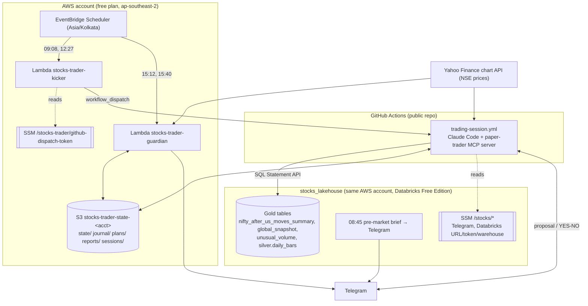

# Architecture

## Overview

## Components

| Component | What it does |
|---|---|
| **Trading session** (GitHub Actions) | Morning (09:08–12:25) and afternoon (12:27–15:25) runs. Claude Code uses the MCP tools in `trader/server.py`; rules in `prompts/trading_rules.md`. |
| **MCP tools** | `premarket_context`, `start_day`, `run_cycle`, `propose_trade`, `wait_for_decision`, `execute_approved_trade`, `wait_for_next_candle`, `end_of_day_report` and a few helpers. |
| **Engine** (`trader/engine.py`) | Dummy ledger, risk gate, sizing, approvals with expiry, simulated fills with slippage and brokerage, stop/target exits, square-off, report. Every rule that matters is enforced in code, not left to Claude. |
| **Brief** (`trader/brief.py`) | Reads the lakehouse gold tables and turns them into the day plan: risk per trade from VIX, bias from India's historical gap after similar US days, unusual-volume and ADR candidates. |
| **S3 state bucket** | The only memory between runs: ledger, journal CSVs, plans, reports, session claims, heartbeat. |
| **Kicker Lambda** | Starts each session on time through the GitHub API. GitHub's own cron is kept as a backup. |
| **Guardian Lambda** | Runs without Claude. Squares off at 15:12 and sends the report at 15:40 if the session didn't (crash, usage limit, runner failure). |
| **CI/CD** | Same as stocks_lakehouse: checks on every push, plan on PR, apply on merge to `main`. |

## Why it's built this way

### 1. The AWS account is on the free plan (re-validated Nov 2026)

The first design used an EC2 server in Mumbai running Claude Code all day. On this account that fails with
`explicit deny in a service control policy`:

| Free-plan rule | First design | Now |
|---|---|---|
| Only `us-east-1`, `us-west-2` and the project region | ap-south-1 (Mumbai) | **ap-southeast-2 (Sydney)** |
| Only S3, Lambda, EventBridge Scheduler, SSM, IAM roles, CloudWatch Logs | EC2, security group, Session Manager, AWS Budgets | **S3, Lambda, Scheduler, SSM, IAM roles only** |
| No IAM identity providers (no GitHub OIDC) | — | IAM users with access keys in GitHub environments, like the lakehouse |
| Admin IAM users are discouraged; sign in with `aws login` | `terraform` user with AdministratorAccess | **Delete that user**; use `aws login` |
| Spend limit is built in | AWS Budget resource | Not needed |

Lambda runs at most 15 minutes, so it can't host a 3-hour Claude Code session. That's why the session runs
in **GitHub Actions** (free for public repos, up to 6 hours per job) and AWS keeps only the small,
always-allowed parts.

### 2. Claude access

The session uses your **Claude Pro/Max subscription** through `CLAUDE_CODE_OAUTH_TOKEN` (from
`claude setup-token`, valid 1 year). No API key. Usage counts against your plan's limits; two ~3-hour
sessions a day are heavy on Pro. If a session hits a limit and stops, the guardian still squares off.

### 3. Sharing with stocks_lakehouse

| Shared | How |
|---|---|
| Terraform state bucket | Same bucket, key `paper-trader/aws/terraform.tfstate` |
| CI plan/apply users | `stocks-gha-plan` / `stocks-gha-apply`. Trader names start with `stocks-` so the apply user's IAM rights (`role/stocks-*`, `user/stocks-gha-*`) cover them |
| Telegram bot and chat | `/stocks/telegram-bot-token`, `/stocks/telegram-chat-id`. The lakehouse only **sends**; the trader is the only **reader** of updates, so there's no conflict |
| Databricks access | `/stocks/databricks-*` parameters, read-only SQL on the gold tables |

### 4. Timing

| Constraint | Decision |
|---|---|
| GitHub cron can start 10–60 min late, and is paused after 60 days without repo activity | Kicker Lambda dispatches at exact times; cron stays as a backup |
| Two triggers could start the same phase | First run claims `sessions/<date>/<phase>` in S3; later ones exit |
| Only one program may read the Telegram bot | Workflow concurrency group `trading-session`; laptop mode must be off |
| A job lasts at most 6 hours | Morning and afternoon sessions |

### 5. Market data

Yahoo Finance's chart API, standard library only. It's free and unofficial and can lag a few minutes or
rate-limit cloud addresses. The `test` session reports whether prices work from GitHub's runners.

## Security model

| Identity | Can | Cannot |
|---|---|---|
| You (`aws login`) | Everything in the project | — |
| `stocks-gha-trader` (session) | Read/write the trader state bucket; read Telegram + Databricks SSM parameters | Delete objects, anything else |
| `stocks-trader-guardian-role` | Read/write the trader state bucket; read Telegram parameters | Databricks, anything else |
| `stocks-trader-kicker-role` | Read the GitHub dispatch token | Anything else |
| `stocks-trader-scheduler-role` | Invoke the kicker and guardian | Anything else |
| Claude in a session | Only the paper-trader MCP tools (`--allowedTools`, `--permission-mode dontAsk`) | Shell, files, web |
| GitHub dispatch token | Start workflows in paper-trader | Anything in other repos |

Trades still need your YES: `execute_approved_trade` refuses anything not approved in code.

## Repository conventions

Same as stocks_lakehouse: work on `dev`, `main` only through pull requests, LF line endings
(`.gitattributes`), shared settings in `infra/aws/project.auto.tfvars`, `terraform fmt` enforced by CI.
